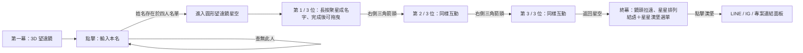

# Starbound｜四人小組・望遠鏡星空揭曉互動網站

> Codex 實作規格 v1.0｜目標：可直接在瀏覽器運行、兼容桌機與手機、有完整互動而非靜態展示。

## 0. 開發任務與優先順序

請開發一個具有電影感、3D 望遠鏡、星空粒子字形與長按互動的單頁網站。使用者先輸入自己的**本名**，接著透過望遠鏡的圓形鏡頭，依序揭曉**其餘三位**組員的名字；所有星座揭曉後，鏡頭拉回完整星空，由星星排列出結尾文字以及可點擊的漢堡選單。

**完成定義：** 不只做出可看的 UI，必須真的能輸入姓名、驗證四人名單、執行 3 次長按、讓粒子聚合成中文／英文姓名、拖曳已形成的星座、翻頁、回到終幕、開啟連結選單，並可編譯。

優先順序：**正確互動狀態 > 星粒子字形清晰度 > 動畫品質 > 裝飾效果**。不要為了華麗動畫犧牲可用性或效能。

## 1. 視覺概念與氣氛

- 主題：**「在星海裡，找到與我同行的人。」**
- 色彩：黑曜石深藍 `#040713`、夜空藍 `#0B1730`、冷白星光 `#F3F7FF`、青藍星芒 `#8FD9FF`、少量溫金 `#F1D6A6`。
- 畫面：沉浸式、暗色系、細緻星塵、景深、微弱星雲、緩慢呼吸光、柔和光暈；避免大量一般網站卡片。
- 美術：3D 望遠鏡有金屬鏡筒、鏡片、腳架或底座、高光材質，滑鼠移動時有輕微視差，足夠讓人直觀辨識為**真 3D 物件**。
- 字體：介面使用繁體中文；星座文字必須支援繁體中文、英文和混合字串。可使用開源字型，並準備繁中字形 fallback。
- 不要使用影片、預先渲染 GIF、固定姓名的圖片來偽裝互動。

## 2. 使用者旅程（共 4 個主要階段）



### Scene 1：3D 望遠鏡（Landing）

1. 首頁全螢幕黑藍色星空。主要視覺為畫面中央略偏下的**真正 3D 望遠鏡**，以 Three.js 建模（可先用 Cylinder、Torus、Lathe 等幾何；之後可選擇換成使用者提供的 `.glb`）。
2. 望遠鏡緩慢浮動／轉動，有鏡片反光、微光、深度視差。背景星星以不同深度分層漂浮。
3. 有簡潔指引：「點擊望遠鏡，尋找你的星光」。點擊 3D 物件或可及性的開始按鈕都能進入下一步。
4. 點擊後，望遠鏡／鏡片有微弱聚焦反應，出現半透明、帶星光邊框的姓名輸入視窗，標題必須是「**請輸入本名**」。
5. 使用者輸入本名、按 Enter 或「開始觀測」。不符合名單時，在原視窗顯示「找不到這個名字，請確認與名單中的本名一致」，不得透露其他組員姓名或直接進入下一幕。
6. 通過驗證後：鏡頭以 3D camera dolly-in 向望遠鏡目鏡前進，透過鏡片的光圈 transition 進入 Scene 2。**不能僅瞬間換背景**。

### Scene 2：圓形望遠鏡星空（連續進行 3 次）

1. 主視覺是中央大型**正圓形**望遠鏡視野，四周保留黑色留白與少量鏡頭外框／金屬環。建議桌機圓直徑 `min(72vh, 65vw, 780px)`、手機直徑 `min(88vw, 70vh)`，依實測調整。
2. 圓形內是有深度的 Three.js 星空：遠景星點、微弱星雲、近景發亮的可動粒子。**嚴格裁切成圓形**，不能讓星星溢出鏡框。
3. 最初，目標星粒子看起來自然地**散落在鏡頭內**，沒有任何姓名輪廓或文字；背景遠星與會聚集成名字的前景星粒子分開渲染。
4. 視野中央有簡潔提示「長按星空，讓星星找到彼此」，可顯示極輕微的同心圓／光波提示；游標／觸控長按該互動區。
5. 使用者**持續長按約 2.8 秒**，分散的前景星點**逐漸移動**到當前組員姓名的實際字形位置。聚合過程須是連續的粒子運動，不得整體淡出後直接顯示 DOM 姓名。
6. 在長按期間，中央有不搶戲的環形聚星進度；中途放開可讓進度**平滑回退**、粒子逐步散開；達到 100% 後姓名鎖定成形，不再散開。
7. 完全成形時：星座姓名略微脈動、微微閃爍，提供「拖曳星座，探索星空」提示；使用者可以**滑鼠／觸控拖曳整組已形成的星座粒子**，整個名字保持原始隊形，不可以把粒子拖散。
8. 拖曳位移需受限在圓形視野的安全範圍，避免姓名大部分被鏡頭裁掉。拖曳途中可有柔和星尾，但停止後粒子仍清晰。
9. 圓形**右側外部**有小巧發光的**三角形「下一頁」**操作。當前名字完全形成後才啟用；未完成時保留可理解的未啟用視覺狀態和提示。進度角標顯示 `01 / 03`、`02 / 03`、`03 / 03`。
10. 點擊下一頁：當前星座先分散成星塵，星空鏡頭可微微轉動／平移到**下一片不同的星區**，再出現新一組散落粒子，長按進度歸零，重複上述互動。每頁使用不同的 deterministic seed／星點配置，不只是換名字。
11. 第三頁完成後，不再出現可按的下一頁，改顯示「**返回星空**」按鈕。按下後觸發 Scene 3。
12. 任何階段不能因外圈 UI 點擊、拖曳或觸控操作誤觸下一頁。長按區與拖曳區按 `revealComplete` 狀態分流。

### Scene 3：拉遠鏡頭＋星光終幕

1. 第三位姓名顯示並完成後，使用者點「返回星空」。
2. 從圓形望遠鏡視野**向外拉遠**：鏡頭縮回、顯露望遠鏡輪廓或鏡片光圈，然後攝影機再抬頭／對準無邊星空，最後停在全螢幕星海。此運鏡需要有鏡頭動線的延續感，不能單純硬切兩個頁面。
3. 黑藍星空中，新的主群星粒子由四面八方**排列成 `TEAM_DATA.md` 內的 `closingMessage` 多行文字**。文字是星點構成；可以加低亮度的筆畫輔助暈光，以確保可讀性，但不能改成只有普通文字突然出現。
4. 同時有另一小群星點在畫面右上角／右側安全區域排列成**三條水平線的漢堡選單形狀**，三條線本體也是星光粒子。
5. 星星漢堡的上方疊一個透明但可及性完整的 HTML `<button>` hit area（例如 48 × 48 px 以上），與粒子圖形對齊，確保可真正點擊。
6. 點擊漢堡：彈出玻璃霧面／星圖式側邊選單，包含 **LINE、Instagram、專案連結（例如 Project、GitHub、其他連結）**；LINE／IG 顯示品牌 icon，其他連結顯示對應或通用 icon。全部資料與 URL 由 `TEAM_DATA.md` 管理。
7. 沒有設定 URL 的項目可先呈現為 disabled／「即將公開」，**不得開啟假的網址**。已設定 URL 的外部連結使用 `target="_blank"`、`rel="noopener noreferrer"`。
8. 側邊選單可以按 X、點 backdrop 或 Esc 關閉。提供「重新探索」小按鈕，可清除當次互動狀態並回到 Scene 1。

## 3. 四人姓名配對規則（核心商業邏輯）

- 資料**僅有四位**組員；輸入者本身**不能**成為自己要看到的三位之一。
- `TEAM_DATA.md` 是唯一人員資料來源。不依姓名首字母寫死判斷，不在 React component 手刻 A/B/C/D 的 if-else。
- 範例：資料順序 A、B、C、D。A 輸入 → 顯示 B、C、D；B 輸入 → 顯示 A、C、D；C 輸入 → 顯示 A、B、D；D 輸入 → 顯示 A、B、C。
- **輸入驗證**：前後空白去除、Unicode `NFKC` 正規化、移除無意義空格，英文大小寫不敏感；中文仍依完整本名精確比對，不做任意模糊猜測。
- 系統應阻止重複本名、缺少 id、不足／超過四人、空姓名、重複 id 的資料設定，顯示可理解的開發階段錯誤訊息。
- 儲存 `currentUserId`、`otherMembers`（固定保留資料原始順序）、`pageIndex`、各頁完成狀態。使用者僅能看到排除自己的 3 個名字。
- 不需要後端、帳號、身份驗證服務，也不需收集或傳送姓名至伺服器。姓名查找在前端本地完成；**此互動不是嚴格的存取控制**，靜態前端資料可被使用者查看。

## 4. TEAM_DATA.md 是可實際讀取的唯一資料來源

網站一定要能**直接讀取專案根目錄 `TEAM_DATA.md` 的 JSON fenced code block**，而不只是 Codex 開發時人工抄寫一次。使用 Vite `?raw` import，以規則式取出唯一的 `json` fenced block，使用 `JSON.parse` 並進行 schema validation。

```ts
// 範例方向（import path 依實際檔案位置調整）
import teamMarkdown from '../TEAM_DATA.md?raw';

const match = teamMarkdown.match(/```json\s*([\s\S]*?)\s*```/i);
if (!match) throw new Error('TEAM_DATA.md 找不到 JSON 設定區塊');
const raw = JSON.parse(match[1]);
// 接著執行驗證，並產出 typed config
```

確保根目錄的檔案修改後，Vite dev mode / 下次 build 會使用最新姓名與連結。**使用者只需要編輯 `TEAM_DATA.md`，不必進入 src 目錄改資料。** 如原專案不是 Vite，可使用等效的 build-time Markdown loader，但需保留同樣體驗。

## 5. 星點聚成姓名的技術要求

### 5.1 必須是真的粒子字形

使用 off-screen `HTMLCanvasElement` 產生文字 alpha mask，不能預製固定名字的 PNG／SVG 字圖：

1. 確認所選繁中字型已載入（`document.fonts.ready`；必要時載入自帶開源字型），避免 Canvas 先採樣空白／方框。
2. 依姓名的字數、字形、圓形鏡頭尺寸，動態計算字級與最多寬度（建議可讀區不超過圓直徑 65–75%）；中文 2–4 字與英文全名皆可 fit。
3. `CanvasRenderingContext2D.fillText` 畫出實際文字，讀取 `getImageData().data`，挑選 alpha 高於門檻的點並做**均勻、可控、非過稀疏**的採樣。
4. 將像素座標映射到星空的 3D 平面座標，為每顆星建立 `startPosition` 和 `targetPosition`；加入輕微 z 深度與獨立閃爍速度。
5. 以 `THREE.Points` + `BufferGeometry`（或自行撰寫 shader）一次繪製大量粒子；在 `useFrame` 中直接更新 buffer，**避免每個星點各自建一個 React component / 每幀 setState**。
6. 長按 progress 控制星星從散落 → 彎曲運動路徑 → 聚合。採用 easing 與微弱流場噪聲／螺旋吸引效果，而不是所有粒子沿完全相同方向直線前進。
7. 完成後仍保留星點閃爍、微光和少量呼吸，但確保**每一筆畫輪廓穩定、姓名可辨識**。
8. 同一個通用 `sampleTextToPoints(text, bounds, font)` 函式也要用在終幕 `closingMessage`；漢堡可用 `samplePolylineToPoints`，依 3 條線段生成星點目標。

### 5.2 星座拖曳

- 使用同一個 `THREE.Group` transform，或為整組粒子加共同位移 offset；拖曳後不能破壞 target 字形。
- Pointer Events 統一滑鼠與觸控，使用 `setPointerCapture`、`pointermove`、`pointerup`、`pointercancel`、`lostpointercapture`。
- 将螢幕座標轉成鏡頭所在平面座標，保留滑鼠起始 offset，不要每次 pointermove 後跳到滑鼠正中。
- 限制星座組中心位置，使字形大部分維持在圓內；頁面切換時拖曳 offset 清零。
- 未完成之前是**長按**，完成之後相同互動範圍才變為**拖曳**，兩者不相互觸發。

### 5.3 互動節流與效能

- 粒子數與畫質依裝置調整：例如名字 1,000–2,000 點（桌機）、600–1,200 點（手機）；背景星場可更多，但要避免高 draw-call。
- `devicePixelRatio` 限制在 1–2；用 buffer update、shader / GPU 運算、共用材質等方式降低負載。
- 未在畫面的 3D 場景可降低更新或卸載；切換時取消 GSAP timeline 與事件監聽。
- 視窗 resize、手機方向改變時，重新計算鏡頭尺寸、文字 mask 和座標，不得讓字體跑出圈外。
- 無法啟用 WebGL 時顯示可用的 2D Canvas fallback（同樣支援姓名驗證、聚字、3 次翻頁、終幕選單），不要空白頁面。

## 6. 動畫時間與轉場（參考節奏，可自行微調）

| 動作 | 建議時間 | 體驗目標 |
| --- | ---: | --- |
| 首頁鏡頭待機 | 緩慢 loop | 讓望遠鏡像真的存在 |
| 通過姓名驗證，鏡頭前進 | 1.2–2.0 秒 | 從 3D 物件平順進入目鏡 |
| 長按星點聚成名字 | 約 2.8 秒 | 使用者持續參與揭曉 |
| 姓名聚合完成星芒 | 0.4–0.7 秒 | 有揭曉成功的回饋 |
| 下一片星空轉場 | 0.8–1.3 秒 | 鏡頭平移，前一姓名散成粒子 |
| 最終鏡頭拉遠並抬頭 | 2–3.5 秒 | 明確感覺離開望遠鏡 |
| 結語星粒子聚字 | 2–3 秒 | 作為情感高潮 |
| 漢堡粒子聚線 | 0.6–1 秒 | 讓最後的互動入口自然浮現 |

可用 GSAP timeline 協調鏡頭與大轉場，星點運動則由 React Three Fiber render loop / shader 負責。不要讓同一組粒子同時由 GSAP 與 `useFrame` 寫入相同座標而互相衝突。

## 7. 互動狀態機（不可任意跳步）

```ts
type Scene = 'landing' | 'name-entry' | 'entering-lens' | 'telescope' | 'returning' | 'finale';
type RevealPhase = 'scattered' | 'forming' | 'completed' | 'dragging' | 'transitioning';

type AppState = {
  scene: Scene;
  currentUserId: string | null;
  revealMemberIds: string[]; // 正好 3 位，不含自己
  pageIndex: 0 | 1 | 2;
  revealPhase: RevealPhase;
  revealProgress: number; // 0..1
  menuOpen: boolean;
};
```

**狀態約束**：
- 未驗證本名前無法進入 `telescope`。
- `revealMemberIds.length` 必須等於 3，否則顯示設定錯誤。
- `revealProgress < 1` 時不可 `dragging` 或 `nextPage`。
- 第 1、2 頁完成才能下一頁；第 3 頁完成才能「返回星空」。
- 下一頁開始 `revealProgress=0`、`dragOffset=(0,0)` 且重新生成該頁星場。
- 在轉場期間，停用會改變場景的重複點擊。
- 終幕菜單開關只影響菜單，不重新觸發姓名揭曉。
- 「重新探索」重置使用者與全部互動狀態，完整回到 landing。

## 8. 技術方案

### 基本技術棧

- **Vite + React + TypeScript**（既有專案若已使用 React/Vite，沿用而非重建）。
- **Three.js + `@react-three/fiber` + `@react-three/drei`**：3D 望遠鏡、星空、鏡片與粒子場。
- **GSAP**：鏡頭推近／拉遠、轉場與 UI 進出場 timeline。
- **`react-icons`**：LINE、Instagram、GitHub 與通用連結 icon。
- CSS / CSS Modules：圓形鏡框裁切、操作提示、輸入框、右側箭頭、終幕側邊選單。不要為了少量元件引入過重 UI framework。
- 需要 bloom 時可使用 `@react-three/postprocessing`，須控制亮度與效能；沒有 bloom 也必須有清楚的星粒子。
- 不使用後端、不需要登入、不使用真實相機／麥克風權限。

### 建議檔案結構（依現有專案彈性調整）

```text
TEAM_STAR_REVEAL_SPEC.md
TEAM_DATA.md
CODEX_PROMPT.md
src/
  App.tsx
  styles/
    globals.css
  config/
    parseTeamMarkdown.ts
    teamTypes.ts
  state/
    useRevealFlow.ts
  components/
    Telescope3D.tsx
    LandingScene.tsx
    NameEntryDialog.tsx
    TelescopeViewport.tsx
    Starfield.tsx
    ConstellationName.tsx
    HoldToReveal.tsx
    SceneNavigation.tsx
    FinaleScene.tsx
    StarHamburger.tsx
    LinkPanel.tsx
  utils/
    sampleTextToPoints.ts
    samplePolylineToPoints.ts
    seededRandom.ts
    normalizeName.ts
  tests/
    teamMatching.test.ts
    parseTeamMarkdown.test.ts
    revealFlow.test.ts
public/
  fonts/  # 必要時放有適當授權的繁中字型；不附帶字型檔時做好 fallback
```

**檔案名稱可調整**，但 `TEAM_DATA.md` 應固定在專案根目錄，且為唯一資料來源。

## 9. 響應式與無障礙

- 桌機 Chrome / Edge 為優先，仍須兼容手機 Chrome / Safari 的觸控。
- 桌機視覺呈現：圓形鏡頭居中，三角形下一頁在其右側外緣；手機時箭頭可浮在外緣右下的安全位置，**不得擋住字形**。
- 滑鼠 `pointerdown`／觸控 `pointerdown`、放開、頁面切換時都要正確結束長按計時，避免持續聚字。
- 互動元件提供鍵盤 fallback：Enter 提交姓名、Space 可模擬長按、Enter/Space 可按下一頁及選單、Esc 關閉彈層。
- `prefers-reduced-motion: reduce` 時縮短／簡化鏡頭運動與粒子暈動，但仍能完成三頁揭曉；對無法長按的使用者，提供清晰可及的替代觸發方式。
- 貼心而不冗長的 ARIA labels、清晰 focus 樣式；所有重要提示具有可讀文字。
- 預防手機長按叫出文字選取／選單，僅在必要互動區設定 `touch-action: none`、`user-select: none`，避免全頁禁止滾動影響操作。

## 10. 驗收條件（全部需要可手動測試）

- [ ] 首頁真的是可互動 3D 望遠鏡，而非平面圖片。
- [ ] 點擊望遠鏡，出現「請輸入本名」；輸錯無法進入、錯誤訊息清楚。
- [ ] A 只能看到 B、C、D；B 只能看到 A、C、D；C 只能看到 A、B、D；D 只能看到 A、B、C。
- [ ] 4 人資料能在 `TEAM_DATA.md` 更改，重新整理／重新 build 即生效，不用改 TS。
- [ ] 圓形視野內星點初始散亂，長按才漸漸排列為**實際姓名**；支援繁中及英文。
- [ ] 長按尚未完成時放開，聚合進度自然倒退，不能直接跳到完整名字。
- [ ] 100% 聚合後，滑鼠和手機都可拖曳整個姓名，且不會被拉散或超出圓形。
- [ ] 每一個名字有不同星空，只有完成本頁才可按三角箭頭進入下一頁。
- [ ] 第三頁結束出現「返回星空」，點擊會完成鏡頭拉遠與視角抬頭的動畫。
- [ ] 終幕星點能排成 `closingMessage`，漢堡圖案本身也由星點排列。
- [ ] 漢堡可以點擊，LINE / Instagram / 專案連結 icon 與資料對應；空白 URL 不可誤導點擊。
- [ ] 不會有 React errors、事件監聽器重複註冊、粒子不消失、圓框跑版、姓名模糊到看不清楚等問題。
- [ ] `npm run build` 成功；有 README 使用說明；若專案有測試框架，相關測試皆通過。

## 11. 明確不做的內容

- 不需會員註冊、後端資料庫、AI 判斷姓名、LINE Login、實體攝影機或手部追蹤。
- 不要先用靜態頁面假裝完成核心動作，再要求使用者後續補齊。
- 不預先猜測組員真實姓名、LINE／IG 地址或結尾想說的話。維持 `TEAM_DATA.md` 可編輯範例，並讓未填欄位不造成故障。
- 不需要把四名組員同時展示在公開首頁。

## 12. 參考文件

- Vite：以 `?raw` 將 Markdown 當字串載入：https://vite.dev/guide/assets
- React Three Fiber：`Canvas`、`useFrame`、raycasting：https://r3f.docs.pmnd.rs/
- GSAP Timeline：https://gsap.com/docs/v3/GSAP/Timeline/
